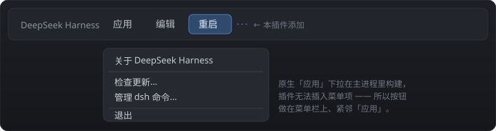
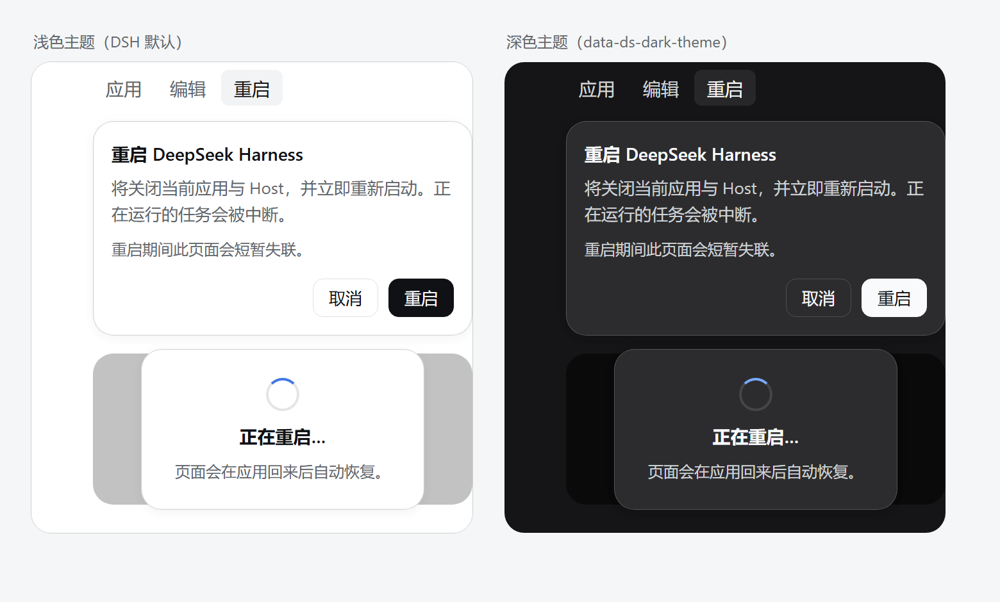

# dsh-restart-button

给 **DSH 桌面端（Windows）** 的标题栏菜单栏加一个「重启」按钮：点一下，整个应用（Electron shell + DSH Host + 渲染进程 + 插件守护进程）退出并自动重新打开。



---

## 为什么需要它

DSH 桌面端的「应用」菜单是 **Electron 主进程** 用原生 `Menu` 弹出的（`applicationItems()`，打包在 `app.asar` 内）。菜单里本来就有一项「重启应用与 Host」，但它被 `development`（`!app.isPackaged`）门槛挡住，**正式安装包里看不到**。

而 DSH 插件运行在 **Host 子进程** 里：

```
"DeepSeek Harness.exe" --expose-internals "...\app.asar\dsh\node_modules\@deepseek-ai\dsh-desktop-host\lib\index.js" ...
```

这个子进程：

- 拿不到 `app.relaunch()` / `app.quit()` —— 那是主进程的 API；
- 没有任何往原生菜单插项的扩展点 —— 菜单项列表硬编码在主进程里；
- 没有「请求主进程重启」的 IPC 通道 —— IPC 只允许主进程 → Host 单向指挥（`shutdown` / `quit-inspection` / `update-tasks`）。

所以插件只能**从外面把应用关掉再拉起来**。这正是本插件做的事：不改 `app.asar`、不依赖桌面端版本、装一次就一直在。

## 工作原理

### host 半边（`host.js`）

| 方法 | 路径 | 说明 |
| --- | --- | --- |
| GET | `/restart-button/status` | 可用性 + 进程信息（`exe`、`appName`、`workdir`、`mainPid`、`hostPid`、`electronVersion`、`logPath`） |
| POST | `/restart-button/restart` | 安排一次重启，立刻返回 `{ ok, via, dryRun, delayMs, scriptPath, logPath }` |

`POST /restart` 的动作序列：

1. 把一段 **VBScript** 助手脚本写到 `%TEMP%\dsh-restart-button-<random>.vbs`；
2. 用一段隐藏的 PowerShell 只做一件事：通过 **WMI**（`Invoke-CimMethod -ClassName Win32_Process -MethodName Create`）以 `wscript.exe //B //Nologo <脚本>` 创建它 —— WMI 创建的进程挂在 `WmiPrvSE.exe` 名下，**不属于本应用的进程树**，因此第 4 步「按 exe 路径杀掉整个应用」不会把助手自己一起杀掉（WMI 不可用时退化为 `spawn(..., { detached: true, stdio: "ignore" })`）；
3. 助手先睡 `1500ms`，让 HTTP 响应先回到页面（否则页面会看到连接被掐断）；host 侧 `waitForHelperStart()` 同时轮询日志里的 `helper started`，2s 内没出现就返回 `helper-did-not-start`（页面提示失败并可重试）；
4. 按 **exe 路径**枚举并终止该应用的所有进程：主进程 + Host + 渲染/GPU 进程 + 用同一个 exe 以 Node 模式跑的插件守护进程（例如 `billion-context` 的 `... start --host 127.0.0.1 --port 18789`），轮询 30s、每 3s 重试终止；
5. 从主进程原始命令行里取出参数（正常情况下为空），再用 WMI `Win32_Process.Create`（`CommandLine` + `CurrentDirectory`）重新启动同一个 exe。

> **为什么用 VBScript 而不是 PowerShell**：v1.0.1 及以前助手是 PowerShell，`Start-Process` 启动的应用会**继承那个 PowerShell 的控制台**，于是重启后桌面上多出一个 shell 窗口，里面滚着 main 进程的 `Checking for update…`、host 的 `dsh web: …` banner 和插件日志。`DeepSeek Harness.exe` 是 GUI 子系统程序，本身不申请控制台；改成 `wscript`（同为 GUI 子系统）且助手内部**只用 WMI**（不用 `taskkill` / `Start-Process`）后，整条重启链路不再产生任何控制台窗口。顺带两个坑：`powershell -WindowStyle Hidden` **挡不住** Windows Terminal 给控制台程序开标签页；`CREATE_NO_WINDOW` 也无法经 WMI 传给 `Win32_Process.Create`（三参重载返回 `21` / `WBEM_E_INVALID_PARAMETER`）。

日志写在 `%TEMP%\dsh-restart-button.log`，每次重启的完整决策链（`helper started (wscript)`、目标 PID 列表、是否 dry-run、重启命令行）都在里面。

### client 半边（`client.js`）

Windows 的「应用 / 编辑」菜单栏不是原生菜单条，而是桌面端 preload **画在页面里的 DOM**（`div[data-windows-menu]`，open shadow root）。client 半边在这个菜单栏里追加第三个按钮「重启」：

- 点击 → 确认气泡（中英双语，跟随 `document.documentElement.lang`）；
- 确认 → `POST /restart-button/restart` → 全屏遮罩 + 每 2s 轮询 `/status`（探不通 = Host 已退出，说明重启已生效）；
- 25s 内仍能探通则提示失败并可重试；
- 2.5s 内找不到菜单栏（例如跑在 `dsh web` 里）→ 退化为右下角浮动按钮 `#dsh-restart-button-floating`。

### 安全边界

两个路由都带栅栏，只接受：**loopback Host** + **非 `cross-site`** + **origin 同源或 `dsh-app://app`** 的请求（与官方插件 `isTrustedApiRequest` 相同的判定口径）。

## 安装

> 前置：DSH 桌面端（Windows）。profile 目录默认 `%USERPROFILE%\.dsh\profiles\desktop`。

### 方式 A：用 dsh-super-injector（最省事，热装配免重启）

如果你装了 **dsh-super-injector**（DSH 插件运行时注入器），直接注入本目录的绝对路径：

```
dev_inject_plugin   dir=<本插件目录绝对路径>
```

或写进 profile（重启后仍在）：

```
dev_install_package dir=<本插件目录绝对路径> profile=desktop
```

> ⚠️ 两种注入方式与 bundle patch 的正式条目**不要同时存在**：`dev_install_package` 会先建一个临时 entry（幽灵），而 `cordis.patch.yml` 的正式 entry 后加载时会因为路由重复报
> `webserver: duplicate prefix route "/restart-button"`。处置：清掉幽灵 entry 后让正式 entry `refresh()`，或干脆重启一次应用（正式条目会正常加载）。

### 方式 B：手动装进 profile

1. 把插件目录放进 profile 的 `node_modules`（目录拷贝或 junction 均可）：

   ```bat
   mklink /J "%USERPROFILE%\.dsh\profiles\desktop\node_modules\dsh-restart-button" "C:\path\to\dsh-restart-button"
   ```

2. 编辑 `%USERPROFILE%\.dsh\profiles\desktop\package.json`：

   ```jsonc
   {
     "dependencies": {
       "dsh-restart-button": "link:C:\\path\\to\\dsh-restart-button"
     },
     "dsh": {
       "profile": {
         "bundles": [
           // ... 其它 bundles ...
           "dsh-restart-button"
         ]
       }
     }
   }
   ```

3. 重启 DSH（关掉桌面端再打开，或重启 `dsh web`）。

### 方式 C：从 GitHub / tgz 安装

在 profile 目录里用 DSH 捆绑的 pnpm 安装，再把包名加进 `dsh.profile.bundles`，然后重启：

```bash
# 直接从 GitHub
pnpm add "dsh-restart-button@github:wangbofan/dsh-restart-button"
# 或从打包产物
pnpm add "file:C:\path\to\dsh-restart-button-1.0.0.tgz"
```

### 卸载

从 `dsh.profile.bundles` 与 `dependencies` 里删掉 `dsh-restart-button`，删掉 `node_modules` 下的链接，重启 DSH 即可（插件不写任何其它位置，除 `%TEMP%` 下的脚本与日志）。

## 使用

标题栏菜单栏：`应用 | 编辑 | 重启` → 点「重启」→ 确认气泡 → 应用关闭并自动重新打开。

> 位置说明：原生「应用」下拉的菜单项列表在 Electron 主进程内，插件无法插入菜单项，所以按钮做在菜单栏上、紧邻「应用」。

## 配色（跟随 DSH 主题）

弹窗、遮罩、按钮**全部使用 DSH 自己的语义 token**（`--dsw-alias-*`），因此和原生菜单一样随外观切换：浅色主题下是「近黑按钮 + 白字」，深色主题下是「近白按钮 + 深字」。没有写死颜色（`var()` 逗号后的值只是 token 缺失时的兜底）。



| 元素 | token | 浅色（DSH 默认） | 深色 |
| --- | --- | --- | --- |
| 菜单栏「重启」按钮 | 继承 preload shadow root 里 `button` 的样式：`interactive-bg-hover` + `label-primary` | 文字 `#61666b`；悬停底 `rgba(38,49,72,.06)`、文字 `#0f1115` | 文字 `#cfd3d6`；悬停底 `rgba(255,255,255,.08)`、文字 `#f9fafb` |
| 弹窗背景 / 边框 | `bg-layer-2` / `border-l4` | `#ffffff` / `rgba(0,0,0,.16)` | `#2c2c2e` / `rgba(255,255,255,.2)` |
| 弹窗阴影 / 圆角 | `elevation-panel` / `radius-lg` | 与 DSH 浮层一致 | 与 DSH 浮层一致 |
| 主按钮「重启」 | `button-primary-fill` + `label-primary-foreground` | 底 `#0f1115`、字 `#ffffff` | 底 `#f9fafb`、字 `#0f1115` |
| 主按钮悬停 | `button-primary-hover` | `#43454a` | `#ebeef2` |
| 次按钮「取消」 | `label-primary` + `border-l3` | 字 `#0f1115`、边 `rgba(0,0,0,.12)` | 字 `#f9fafb`、边 `rgba(255,255,255,.16)` |
| 重启遮罩 | `bg-mask-1` | `rgba(0,0,0,.24)` | `rgba(0,0,0,.5)` |
| 浮动兜底按钮 | `button-floating-fill` + `border-l3` | 底 `#ffffff`、字 `#0f1115` | 底 `#2c2c2e`、字 `#f9fafb` |
| 转圈 | `state-business-primary` | `#4176e6` | `#7aaaff` |

> v1.0.0 曾用 `--dsw-alias-brand-primary` 当主按钮底色：深色主题下它是近白色（`#f9fafb`），而文字写死 `#fff` —— 按钮上的字几乎看不见。现已改成 DSH 原装的 `button-primary-fill` + `label-primary-foreground` 配对。

## 配置

| 环境变量 | 作用 |
| --- | --- |
| `DSH_RESTART_BUTTON_DRY_RUN=1` | 演练模式：助手只把将要终止的 PID 与重启命令行写进日志，**不真的杀进程**。也可以不设环境变量、临时用 `POST /restart-button/restart?dryRun=1` 演练一次 |

代码内常量（`host.js`）：`ROUTE_PREFIX = "/restart-button"`、`HELPER_DELAY_MS = 1500`。

## 自测

`GET /restart-button/status` 会打印主进程 PID 与 exe 路径，把它们喂给自测脚本（用 DSH 捆绑的 node，本机 `node` 不在 PATH 时）：

```powershell
& "$env:USERPROFILE\.dsh\dsh-runtimes\dsh-primary-runtime\dependencies\node\bin\node.exe" `
  tools\self-test.mjs <mainPid> "C:\Users\22437\AppData\Local\Programs\DeepSeek Harness\DeepSeek Harness.exe"
```

它跑 8 项断言，整个过程不碰正在运行的应用：

1. 生成的助手源码里不含 `powershell` / `Start-Process` / `taskkill` / `cmd.exe`；
2. **用与插件完全相同的 WMI 方式**启动 wscript 助手；
3. 读日志断言 `helper started (wscript)` 与 `targets: <pids>`；
4. dry-run 走到 `dry run: would start: <exe>`；
5. 启动前后 `conhost` 进程数必须不变（证明没创建控制台宿主 —— 这正是 .vbs 助手的意义）；
6. 用 VBS 的 `Win32_Process.Create`（助手重启应用所用的同一个原语）创建进程写文件，断言成功。

实测输出（本机 8 个同 exe 进程）：

```
helper started (wscript) target=16852
targets: 5168, 16852, 19352, 3296, 18780, 20500, 15968, 9348
dry run: the application is left running
dry run: would start: C:\...\DeepSeek Harness\DeepSeek Harness.exe
conhost before=5 after=5
launchapp returned 19868
```

配色自测：`tools/theme-preview.html` 把 DSH 两套 token 值内联进去、复用 `client.js` 的 CSS 渲染浅/深两版弹窗，用无头 Edge 截图即得 `assets/theme-preview.png`：

```powershell
& "C:\Program Files (x86)\Microsoft\Edge\Application\msedge.exe" --headless=new --disable-gpu --hide-scrollbars `
  --force-device-scale-factor=2 --window-size=780,470 --screenshot=assets\theme-preview.png tools\theme-preview.html
```

## 兼容性与限制

- 仅 **Windows 桌面端**；`dsh web` 下 `capabilities()` 会返回 `available: false`（`reason: "not-supervised"`），client 半边退化为浮动按钮但点击会提示不可用。
- **不是优雅关闭**：按 exe 路径硬杀进程树，正在跑的任务会被中断（确认气泡里有提示）。
- 不修改 `app.asar`，桌面端更新后依然有效。
- 重启后窗口位置/会话由桌面端自己恢复；本插件不保存任何状态。

## License

MIT © wangbofan

---

## English (brief)

`dsh-restart-button` adds a **Restart** button to the DSH desktop titlebar menu bar (Windows). The native「应用」dropdown is built inside the Electron main process and has no plugin extension point, and plugins run in the *Host child process* with no way to call `app.relaunch()`. So the Host half (`host.js`) exposes `POST /restart-button/restart`, which writes a **VBScript** helper and creates it as `wscript.exe //B //Nologo <script>` through **WMI** (so it lives outside the app's process tree), waits 1.5s, kills every process of the app by executable path, and relaunches the exe through WMI only. The helper is deliberately *not* PowerShell and never calls `taskkill`/`Start-Process`: those are console programs, and a console started by the helper is inherited by the relaunched app, which leaves a stray shell window full of `Checking for update…` / `dsh web:` logs (fixed in 1.0.2). The client half (`client.js`) appends a「重启 / Restart」button to the titlebar menu bar (an open shadow root rendered by the desktop preload) with a confirm popover. Every color comes from DSH's own `--dsw-alias-*` tokens, so the popover follows the shell theme (near-black button with white text in light mode, near-white button with dark text in dark mode). Windows only; hard restart (running tasks are interrupted); no `app.asar` patching.
